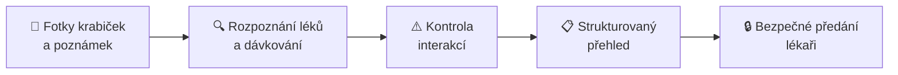

# 💊 PillGaze

**Z fotky krabičky k přesné farmakologické anamnéze.**

Mobilní AI nástroj, který z fotografií léků a ručně psaných poznámek sestaví strukturovaný přehled medikace pro ošetřujícího lékaře.

Zadavatel: **Masarykův onkologický ústav**

---

## 🩺 Problém

Sběr farmakologické anamnézy je zdlouhavý a náchylný k chybám. Pacienti často nosí na vyšetření tašku plnou krabiček, letáků a ručně psaných poznámek o dávkování. U onkologických pacientů je situace ještě citlivější – kombinují protinádorovou léčbu s dalšími léky, doplňky stravy a volně prodejnými přípravky, a každá neodhalená interakce může mít vážné následky.

## 💡 Řešení

PillGaze promění fotografie krabiček a ručně psaných poznámek v přesnou, strukturovanou anamnézu:

1. **📸 Vyfoť** – pacient (nebo zdravotník) nafotí krabičky léků a poznámky v mobilu.
2. **🔍 Rozpoznej** – AI identifikuje užívané léky, sílu, dávkování i onkologickou léčbu.
3. **⚠️ Upozorni** – systém zkontroluje možné lékové interakce a označí rizikové kombinace.
4. **📋 Shrň** – vznikne přehledný strukturovaný výpis medikace.
5. **🔒 Předej** – výsledek se bezpečně a srozumitelně předá ošetřujícímu lékaři.

## ✨ Klíčové funkce

- **Rozpoznání léků z fotografie** – názvy přípravků, účinné látky, síla, léková forma
- **Čtení ručně psaných poznámek** – dávkovací schémata, časy užívání, poznámky pacienta
- **Podpora onkologické léčby** – zachycení protinádorových režimů a podpůrné medikace
- **Upozornění na interakce** – zvýraznění potenciálně nebezpečných kombinací
- **Strukturovaný výstup** – přehled připravený k rychlé kontrole lékařem
- **Bezpečné sdílení** – předání dat ošetřujícímu lékaři s důrazem na ochranu osobních údajů

## 📦 Repozitáře

| Repozitář | Popis |
| --- | --- |
| [`mobile-app`](../../mobile-app) | Mobilní aplikace pro pořízení fotografií a zobrazení přehledu |
| [`backend`](../../backend) | API, zpracování obrázků a správa dat |
| [`ml`](../../ml) | Modely pro rozpoznávání léků a textu |
| [`docs`](../../docs) | Dokumentace, architektura a návrhy |

> _Upravte tabulku podle skutečných repozitářů organizace._

## 🛠️ Technologie

> _Doplňte použitý stack – např. framework mobilní aplikace, backend, OCR/vision modely, databázi lékových interakcí (SÚKL apod.)._

## 🔐 Bezpečnost a soukromí

Pracujeme se zdravotními údaji, a proto:

- s daty zacházíme v souladu s **GDPR** a zásadou minimalizace dat,
- přenos i uložení dat je **šifrované**,
- výstup je určen **výhradně ošetřujícímu lékaři**.

## ⚠️ Upozornění

PillGaze je **podpůrný nástroj**, nikoli zdravotnický prostředek. Nenahrazuje odborný úsudek lékaře ani lékárníka. Veškeré výstupy – včetně upozornění na interakce – musí ověřit kvalifikovaný zdravotník.

## 👥 Tým

| Jméno | Role |
| --- | --- |
| _Jméno_ | _Role_ |
| _Jméno_ | _Role_ |

---

Vytvořeno pro <b>Masarykův onkologický ústav</b> 💙

